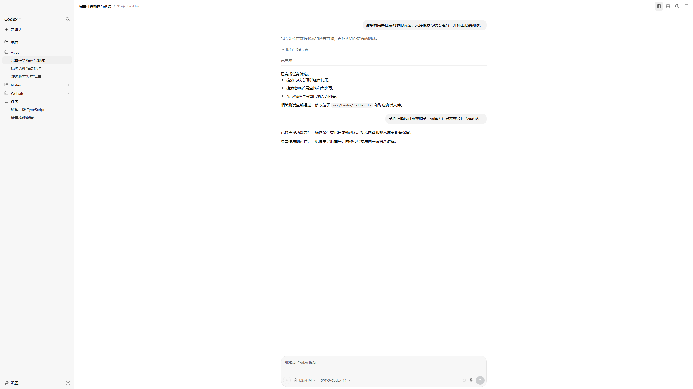
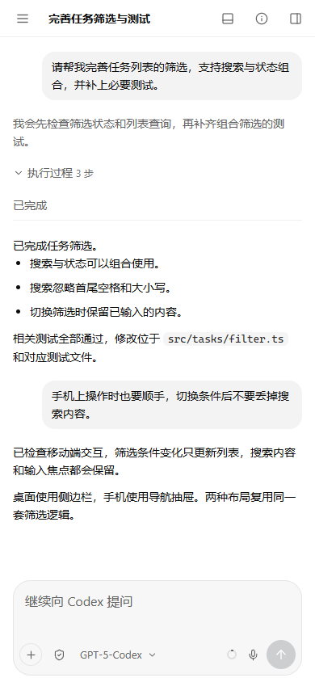
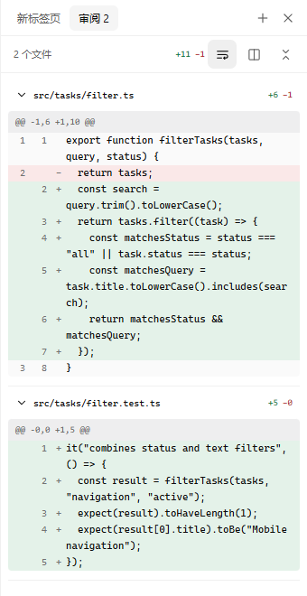
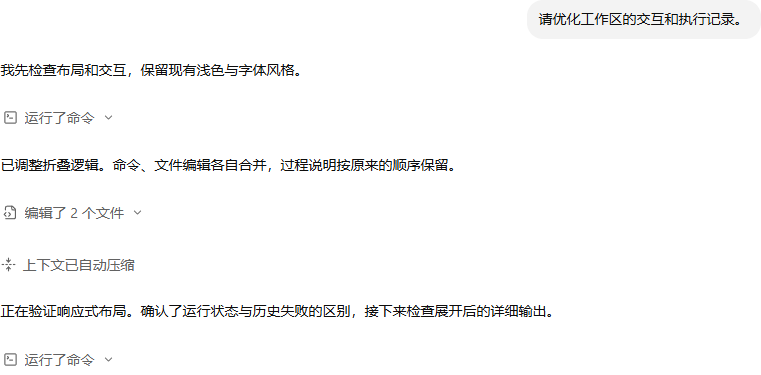

# Codex Remote

[English](README.md) | [简体中文](README.zh-CN.md)


[](LICENSE)
[](https://github.com/CoralFlower325/Codex-remote/actions/workflows/ci.yml)

A self-hosted web workspace for Codex Desktop. Continue chats, review changes, switch models, and respond to approvals from a phone or another computer.

The browser uses the local desktop's owning App Server through a private desktop bridge. It renders a responsive workspace rather than streaming a scaled desktop screen. Windows and macOS have installation and background service controls; both platforms are covered by CI. A signed-in Windows desktop has live acceptance; a signed-in macOS desktop still needs equivalent live acceptance.

Community project. Not affiliated with or endorsed by OpenAI.



## Screenshots

The screenshots show the actual frontend with synthetic projects, messages, paths, and model metadata. They contain no real account, conversation, or deployment data. The model shown is illustrative; available models depend on the connected runtime.

| Phone workspace | Change review |
| --- | --- |
|  |  |

Desktop capture: **2560 × 1440**. Phone capture: **390 × 844 CSS pixels**. These are capture sizes, not fixed rendering resolutions. The UI uses the browser's viewport and device pixel ratio, so a 390 × 844 CSS viewport on a 3× screen is rendered at 1170 × 2532 physical pixels.

The mobile layout activates below 720 CSS pixels wide, or below 980 pixels when the width/height ratio is less than 1.18. It includes dynamic viewport height and safe-area spacing. Reference viewport sizes are 2560 × 1440, 1440 × 900, 1024 × 768, 390 × 844, and 320 × 568.

## Features

- **Shared desktop chats.** Open and continue chats through the same desktop backend, including activity originating in Desktop.
- **Projects and task navigation.** Browse all providers' tasks with paginated loading, search, archived browsing, rename, archive, and restore.
- **Readable long histories.** Load older pages on demand, preserve the reading position, and fold consecutive commands and file edits by operation type while keeping commentary visible.
- **Native model metadata.** Model choices and supported reasoning levels come from the runtime, including custom model catalogs exposed by it.
- **Slash commands.** Search commands and native skills from the composer, with keyboard and touch selection, native plan mode, compaction, reviews, and chat forks.
- **Per-chat permissions.** Choose native read-only, workspace, or full-access profiles and respond to supported approval requests.
- **Images and review.** Upload or paste images, open originals, inspect changed files, and use unified or split diffs.
- **Responsive light UI.** Drag the desktop sidebar and review dividers to resize all three columns; widths are remembered in the current browser, and double-clicking restores defaults. Phones use navigation drawers, with a compact composer and system typography.
- **Connection recovery.** Heartbeat deadlines, handshake timeouts, network/foreground recovery, and drafts stored per chat in the browser.
- **Self-hosted access.** Password login, signed HTTP-only sessions, local-only initial setup, and optional Cloudflare Tunnel.
- **Windows and macOS controls.** Double-click `.cmd` files on Windows or `.command` files on macOS to start and stop Remote.

## Execution Records

Commands and file edits appear as compact, collapsed rows in their original
conversation order. Expand a row to inspect commands, output, changed paths, and
available file diffs. Consecutive operations of the same type share one row;
progress messages stay visible. Empty native reasoning records do not produce
blank fold rows; the stored history is preserved.

The issue shortcut filters failed and declined records, with separate status
labels. A tool failure does not mark the whole turn as failed. Running indicators
follow the active native turn, including when it ends with stale item statuses.
Long groups show the latest 60 records initially and load 120 earlier records at
a time. Log bodies mount only when opened; expanding preserves reading position.

Conversation and activity typography follows measurements from Windows Codex
Desktop: the system font stack, 14px text at weight 430, 22.75px paragraph line
height, and 21px activity-header line height. Font rendering still depends on the
operating system, browser, scaling, and available system fonts.



## Slash Commands

Type `/` at the start of the composer to browse commands and enabled skills. Filter by typing, use Up/Down and Enter/Tab to select, or tap an entry. Escape closes the menu without losing the draft. Chinese IME confirmation does not submit a command.

| Command | Action |
| --- | --- |
| `/new` | Start a new chat; `/clear` is an alias |
| `/model` | Open the native model picker; `/model <model-id>` selects a catalog entry |
| `/reasoning` | Open the current model's reasoning levels; accepts a supported level as an argument |
| `/permissions` | Open per-chat permissions; `/approvals` is an alias |
| `/plan` | Toggle native plan mode; `/plan on` and `/plan off` select it explicitly |
| `/skills` | Browse enabled skills in the current working directory |
| `/<skill-name>` | Attach an enabled skill to the next message using native skill input |
| `/compact` | Request native context compaction for the current saved chat |
| `/review` | Choose uncommitted changes, a base branch, a commit, or custom review instructions |
| `/fork` | Fork the saved chat and open the new chat with bounded history |
| `/rename` | Open rename; `/rename <name>` renames directly |
| `/diff` | Open the changed-file inspector for the loaded history |
| `/status` | Show connection, model, reasoning, mode, permissions, directory, and context usage |
| `/mcp` | Read native MCP server status, following all returned pages |
| `/help` | Return to the command menu |

Selecting a skill adds a removable attachment; enter the request and send it normally. Skill input also works when adding instructions to an active turn. Disabled skills are excluded, and `/skills` still exposes skills whose names overlap built-in commands.

`/plan <request>` enables plan mode and leaves the request in the composer for review before sending. Plan settings use the selected provider model and reasoning level, and Desktop-origin mode updates are reflected in Remote. Compaction, review, and fork require a saved chat; they and mode changes are unavailable while a turn is active. Existing images remain attached when using settings commands.

Commands call the owning App Server or open the corresponding UI. A failed command keeps its draft and reports the native error. Unknown slash words are not silently sent to the model. Paths containing further slashes and multiline messages remain ordinary text. The available list is the adaptation above, not every CLI-only or Desktop-only command; unsupported runtime methods report an error. Native compaction/review/fork mutations have synthetic browser acceptance; this release's live native check covers skill/mode/MCP reads, not model-billed reviews or compaction on real chats.

## How It Works

```text
Phone / computer browser
        |
        | HTTPS + WebSocket
        v
Cloudflare Tunnel (optional)
        |
        v
Local Node.js server (127.0.0.1:4545)
        |
        | Private CDP bridge (127.0.0.1:9229)
        v
Codex Desktop -> its owning App Server
```

When Desktop is unavailable, Remote can fall back to a standalone App Server. Standalone mode does **not** share the desktop process's live events. Check the active transport at `/health`.

## Requirements

| Component | Requirement |
| --- | --- |
| Host | Windows 10/11, or macOS |
| Runtime | Node.js **22.19 or later**, with npm |
| Codex | Installed and authenticated Codex Desktop / compatible bundled CLI |
| Desktop sync | Desktop debug endpoint on loopback port `9229` |
| Public access | Optional `cloudflared`; a Cloudflare-managed hostname for the Windows helper |
| Windows tunnel helper | PowerShell 7 and an authenticated `cf` CLI |

This application uses internal desktop interfaces. Compatibility may change when Codex Desktop updates. Linux desktop integration is not validated.

## Quick Start

### 1. Clone

```bash
git clone https://github.com/CoralFlower325/Codex-remote.git
cd Codex-remote
```

### 2. Enable Desktop Synchronization

Save your work and fully quit Codex Desktop before launching it with the debug argument. This setup does not require Remote to restart Desktop during normal use.

For a Windows Store installation, in PowerShell:

```powershell
$package = Get-AppxPackage -Name "*Codex*" | Select-Object -First 1
& (Join-Path $package.InstallLocation "app\Codex.exe") --remote-debugging-port=9229 --remote-debugging-address=127.0.0.1
```

For another Windows installation, launch its actual `Codex.exe` with the same arguments. Package layouts can vary.

On macOS:

```bash
open -a Codex --args --remote-debugging-port=9229 --remote-debugging-address=127.0.0.1
```

Verify locally:

Windows:

```powershell
Invoke-RestMethod http://127.0.0.1:9229/json/list
```

macOS:

```bash
curl --fail http://127.0.0.1:9229/json/list
```

The result should include a page whose URL contains `app://-/index.html`. Keep this endpoint private; it can control the local app.

### 3. Install and Run

**Windows**

```powershell
npm run setup:windows
npm start
```

The setup script installs locked dependencies, builds the app, and prompts for an access password if one does not exist.

**macOS**

```bash
npm run setup:macos
npm start
```

Both setup commands use the lockfile, build the app, and ask for the first access password. Use `.env` for settings that must also apply to background services.

Open **http://127.0.0.1:4545** and sign in. Initial password setup is accepted only from the host computer.

### 4. Confirm the Transport

Windows:

```powershell
Invoke-RestMethod http://127.0.0.1:4545/health
```

macOS:

```bash
curl --fail http://127.0.0.1:4545/health
```

For live desktop synchronization, expect `codex: ready` and `transport: desktop`. A `standalone` transport means Remote is using a separate App Server.

## Windows Start / Stop

After building and setting the password:

| File | Behavior |
| --- | --- |
| `Start Remote.cmd` | Enables and starts scheduled tasks, checks local readiness, and opens the configured page |
| `Stop Remote.cmd` | Stops server and tunnel, and disables their login tasks |

Stopping Remote leaves Codex Desktop running. The tasks stay disabled across sign-in until Start is used again. Repeated Start does not create another running instance.

The first Start installs the current-user scheduled tasks when they are missing. If `data/cloudflared-token` exists, the tunnel task is included.

For terminal use:

```powershell
powershell.exe -NoProfile -ExecutionPolicy Bypass -File scripts/remote-control-windows.ps1 -Action Start -NoBrowser
powershell.exe -NoProfile -ExecutionPolicy Bypass -File scripts/remote-control-windows.ps1 -Action Status
powershell.exe -NoProfile -ExecutionPolicy Bypass -File scripts/remote-control-windows.ps1 -Action Stop
```

Task installation and removal:

```powershell
npm run install-task:windows
npm run uninstall-task:windows
```

## macOS Start / Stop

After `npm run setup:macos`, use the executable files from a Git clone:

| File | Behavior |
| --- | --- |
| `Start Remote.command` | Installs a current-user LaunchAgent if absent, enables login startup, checks readiness, and opens the configured page |
| `Stop Remote.command` | Stops Remote and disables login startup; Codex Desktop remains open |

No administrator account is needed for the Remote service. The helpers find Node in the current `PATH` and standard Apple Silicon / Intel Homebrew paths. Codex detection includes `/Applications` and `~/Applications`; `CODEX_BINARY` can override detection.

```bash
npm run start:macos -- --no-browser
npm run status:macos
npm run stop:macos
npm run uninstall-service:macos
```

The service lives at `~/Library/LaunchAgents/com.codex.remote.plist`. Logs go to `DATA_DIR` (default `data/`). Another checkout's existing service is left untouched. Changes to `.env` take effect after stopping and starting Remote.

The macOS controls manage the Remote web server. An independently installed `cloudflared` service or reverse proxy is managed separately; stopping Remote closes its web endpoint. Windows controls also manage the project's configured tunnel task.

ZIP downloads may lose executable permissions. Restore them with `chmod +x *.command`, or use the npm commands above. If Node was installed with a shell version manager and Finder cannot find it, run Start from an initialized terminal once to install the service with the resolved Node path.

## Public Access

Local access does not require a domain. For a stable public URL, configure a hostname such as `codex.example.com`.

### Windows Cloudflare Helper

Install `cloudflared` and PowerShell 7, install the Cloudflare `cf` CLI, and authenticate:

```powershell
npm install --global cf
cf auth login
cf auth whoami
npm run tunnel:windows -- -PublicHost codex.example.com
```

The helper creates or reuses a remotely managed tunnel, sets its ingress, creates a matching DNS record when absent, saves the tunnel token locally, updates `.env`, and installs login tasks. An existing DNS record pointing elsewhere is not overwritten.

The tunnel targets `http://127.0.0.1:4545`. Its readiness endpoint is `http://127.0.0.1:20241/ready`; ordinary connection logs are written to `data/cloudflared.log`. These are local diagnostics.

### macOS

The included `scripts/cloudflared-tunnel.sh` is a legacy, interactive, locally managed setup. It writes `~/.cloudflared/config.yml` and installs a system service, requiring `sudo`. Review it before use if cloudflared is already configured. This path has not been revalidated on macOS in this release.

Another HTTPS reverse proxy is possible when it supports WebSocket upgrades and forwards to the local server. Set `PUBLIC_ORIGIN` and `ALLOWED_ORIGINS` accordingly. Do not expose the desktop debug port.

## Configuration

Copy `.env.example` to `.env` for overrides:

Windows:

```powershell
Copy-Item .env.example .env
```

macOS:

```bash
cp .env.example .env
```

| Variable | Default | Purpose |
| --- | --- | --- |
| `HOST` | `127.0.0.1` | Local web listener |
| `PORT` | `4545` | Web server port |
| `PUBLIC_ORIGIN` | Empty | Final HTTPS origin |
| `ALLOWED_ORIGINS` | Empty | Additional comma-separated browser origins |
| `CODEX_BINARY` | Auto-detected | Explicit path to the bundled Codex CLI |
| `CODEX_HOME` | `~/.codex` | Codex state and configuration directory |
| `CODEX_WORKDIR` | Home directory | Default working directory |
| `CODEX_DESKTOP_DEBUG_PORT` | `9229` | Local Desktop debug endpoint |
| `TRUST_PROXY` | `1` | Trust forwarding headers behind the intended local proxy |
| `SESSION_DAYS` | `30` | Browser session lifetime |

Keep `HOST` on loopback when using a local tunnel or reverse proxy. The Windows tunnel helper assumes port `4545` unless you pass its `-LocalUrl` parameter.

Codex CLI detection checks Windows app packages, local standalone installations, and `PATH`. On macOS it checks supported app locations, the local standalone installation, and `PATH`. Set `CODEX_BINARY` if auto-detection does not find your installation.

## Models, Permissions, and State

- Models are read from native `model/list`; reasoning levels use each model's `supportedReasoningEfforts`. There is no fixed universal set of available levels.
- Custom providers are configured in Codex, not in a separate Remote provider editor. Their exposed catalog determines the available choices.
- Model and project metadata load in the authenticated bootstrap and refresh on reconnection. They are not continuously refreshed while the connection stays open. Currently, these two lists read their first requested page; task history, task lists, and permission profiles have separate pagination.
- New chats currently initialize reasoning from the model catalog default. This can differ from a global Codex configuration override; select the desired level explicitly.
- Permission profiles come from `permissionProfile/list` and update the current chat. Builtins include `:read-only`, `:workspace`, and `:danger-full-access`.
- Unsent drafts live in browser `sessionStorage`. They survive switching chats and reconnecting, but do not synchronize with the Desktop composer or other devices.
- Uploads are sent to the local Codex workflow. The remote UI does not implement a separate hosted model service.

## Loading and Mobile Networks

- The login shell loads separately from the workspace. One authenticated bootstrap supplies the first task page, models, and projects; subsequent task pages appear progressively until the full list is loaded.
- Opening a chat combines its native metadata and latest 40 history items in one request. Older history remains available in pages of up to 100 items. Switching back to one of the five recently opened chats shows its in-memory snapshot while refreshing from the desktop; snapshots disappear on logout or page reload.
- HTTP responses and supported WebSocket messages use compression. Fingerprinted assets have immutable caching; authenticated bootstrap and history responses use `no-store`.
- Initial metadata waits at most 1.5 seconds per native request before the workspace falls back to its normal connection refresh. Returning to the foreground avoids redundant refreshes within 15 seconds; native live events continue immediately.
- A slow tunnel can still dominate loading time. Compare localhost with the public origin and inspect `data/cloudflared.log`. For repeated QUIC stalls, test the tunnel's `--protocol http2` setting on that host. This is a deployment choice, not the default for every installation.
- Phone browser sizes are CSS pixels. Tests include 390x844 and 320x568, plus a DPR 3 touch context; they do not replace measurements on your actual phone and network.

## Security and Privacy

This is a control surface for **one trusted operator's own machine**, not a multi-user hosting platform. A logged-in operator can access chats, images, and the capabilities allowed by the selected native permission profile.

- Set a strong access password and use HTTPS for remote access.
- Passwords use salted `scrypt` hashes. Sessions use signed, HTTP-only cookies, with `Secure` enabled over HTTPS and `SameSite=Strict`.
- Wrong-password attempts are rate-limited. Reset the password locally with `npm run set-password`.
- Keep `.env`, `data/`, tunnel credentials, session secrets, logs, and browser authentication exports private.
- Keep the Codex debug endpoint and the App Server transport on the host. Publish only the protected web origin.
- Full access can execute host actions; review the permission profile before running a task.

The source release excludes local runtime data and old development history. Documentation screenshots use synthetic data. See [SECURITY.md](SECURITY.md) for private vulnerability reporting.

## Development

```bash
npm ci
npm run dev
```

Vite serves the frontend, and the development server forwards API/WebSocket traffic to the local backend. Do not run another Remote backend against the same desktop relay while a production instance is active.

```bash
npm run typecheck
npm test
npm run build
```

The suite has **72 tests across 17 test files**. CI runs type checking, tests, and a production build on Windows, macOS, and Ubuntu. The macOS job also checks shell syntax and validates the generated LaunchAgent with the native plist tools. These checks do not replace testing against a signed-in desktop; an Ubuntu build does not establish Linux desktop support.

```text
src/client/       React workspace, composer, history, approvals, reconnect
src/server/       Express, authentication, desktop bridge, native history
src/shared/       Protocol and permission helpers
scripts/          Setup, services, tunnel, and platform controls
public/           Application assets
docs/images/      Sanitized documentation screenshots
```

## Known Limits

- Interface labels are currently Simplified Chinese; both English and Chinese documentation are provided.
- This is an independent adaptation, not a pixel-exact copy of every Codex Desktop screen.
- Internal Desktop protocol changes can break synchronization; standalone fallback cannot reproduce Desktop live events.
- Command records are not an interactive terminal. The inspector derives review and file information from loaded chat history, not an unrestricted project explorer.
- Live command approval is verified. File-change, user-input, and persistent command/network-policy approvals have helpers and tests but still need dedicated live acceptance.
- Browser dictation requires browser support and microphone permission; actual spoken input has not been accepted in the release verification.
- Heartbeats recover stale connections, but cannot guarantee network uptime. Interrupted requests are not replayed automatically.
- Windows is the live-tested deployment. macOS has build, unit-test, shell, and LaunchAgent CI coverage, but live desktop sync, login persistence, and the legacy tunnel still require acceptance on a signed-in Mac.

## Troubleshooting

| Symptom | Check |
| --- | --- |
| Desktop chats do not update live | `/health` must report `transport: desktop`; confirm the debug target and authenticated Desktop app |
| History appears incomplete | Load older history pages; confirm that the app is using the owning Desktop backend |
| A model or reasoning level is absent | Check the catalog returned by Codex; reconnect after changing the provider |
| Windows Start cannot find build output | Run `npm ci` and `npm run build` first |
| Public URL fails but localhost works | Check tunnel readiness, its login task, DNS, and `data/cloudflared.log` |
| Connection stalls after sleep | Return to the foreground or restore the network; the client probes and reconnects |
| Password forgotten | Run `npm run set-password` on the host |
| Codex logs an ignored global setting | Check your local Codex config; Remote does not manage deprecated global settings |

When reporting a problem, include the operating system, Node version, relevant Codex version, transport, and a redacted error. Never include tokens, `.env`, auth files, raw chat exports, or unredacted screenshots.

## Contributing

Issues and pull requests are welcome. Read [CONTRIBUTING.md](CONTRIBUTING.md) for setup, verification, and privacy expectations.

## Credits and License

Released under the [MIT License](LICENSE).

- Original project: [Bones-star588/codex-remote](https://github.com/Bones-star588/codex-remote), copyright 2026 lezi-fun.
- Workspace and review UI reference: [Bones-star588/codex-webui](https://github.com/Bones-star588/codex-webui), copyright 2026 lezi-fun.
- Windows port and this distribution: [CoralFlower325](https://github.com/CoralFlower325).
- Built with React, TypeScript, Vite, Express, WebSocket, and Lucide icons.

Full upstream notices are preserved in [THIRD_PARTY_NOTICES.md](THIRD_PARTY_NOTICES.md). Codex and related branding belong to OpenAI; the software license does not grant trademark rights.
