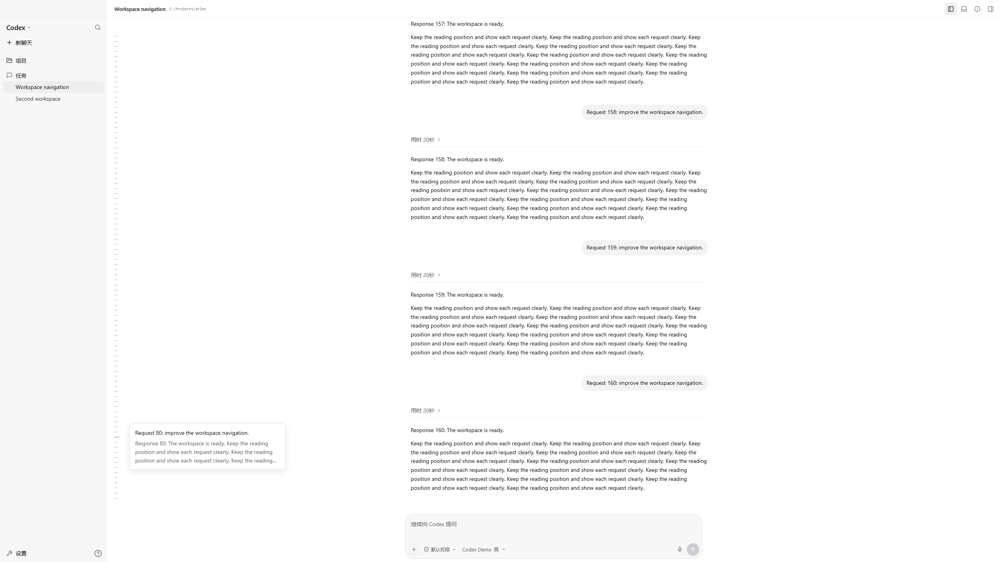
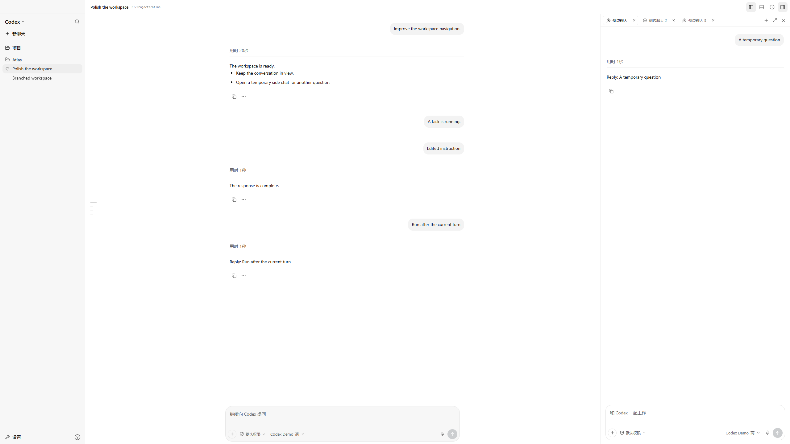

# Codex Remote

[English](README.md) | [简体中文](README.zh-CN.md)


[](LICENSE)
[](https://github.com/CoralFlower325/Codex-remote/actions/workflows/ci.yml)

一个自托管的 Codex Desktop 网页工作区。通过手机或另一台电脑继续会话、查看代码变更、切换模型，并处理审批请求。

网页通过本机私有桥接连接桌面端所属的 App Server，提供响应式界面。Windows 和 macOS 均提供安装、后台服务及开关，并纳入 CI。Windows 已完成登录桌面端的实机验收；macOS 登录桌面端仍需同等实机验收。

本项目由社区独立维护，与 OpenAI 无隶属或背书关系。


## 界面预览

截图来自实际前端，项目、聊天、路径和模型信息均使用虚构演示数据，不包含真实账户、会话或部署信息。截图中的模型仅用于演示，可选模型由实际连接的 Codex 运行时决定。

| 手机工作区 | 代码变更审阅 |
| --- | --- |
|  |  |

桌面截图分辨率：**2560 × 1440**。手机截图：**390 × 844 CSS 像素**。这些是截图尺寸，不是网页固定渲染分辨率。页面跟随浏览器视口及设备像素比渲染，例如 3 倍屏幕上的 390 × 844 CSS 视口对应 1170 × 2532 物理像素。

宽度小于 720 CSS 像素，或宽度小于 980 且宽高比小于 1.18 时，启用手机布局；同时考虑动态视口高度和屏幕安全区域。参考视口尺寸为 2560 × 1440、1440 × 900、1024 × 768、390 × 844 和 320 × 568。

## 主要功能

- **共享桌面端会话**：通过同一个桌面后端打开和继续会话，接收桌面端发起的实时活动。
- **项目与任务导航**：按项目组织全部供应商的任务，支持分页、搜索、归档浏览、重命名、归档与恢复。
- **长会话展示**：按需加载更早记录，保留阅读位置，采用桌面端风格的活动摘要与已完成回合折叠。
- **回合导航**：桌面使用原生风格的小横线，预览提问与回复并跳转；手机使用可点选列表。
- **侧边聊天与待发消息**：在检查器标签中打开临时聊天。主聊天支持排队、编辑、删除、引导当前回合，以及将消息转入侧聊。
- **工作区与回复操作**：新建宿主文件夹并添加为项目，在侧栏归档聊天，复制回复，以及从指定回复分支。
- **原生模型信息**：模型列表和推理强度来自运行时，也能展示其暴露的自定义模型目录。
- **会话级权限**：选择原生只读、工作区或完全访问权限，并回复支持的审批请求。
- **图片与代码审阅**：上传或粘贴图片、查看原图，按文件审阅变更，支持统一与并排差异视图。
- **工作区终端**：在当前聊天或项目目录打开交互式 shell，支持多标签、Ctrl+C、保留进程与断线恢复。
- **响应式浅色界面**：桌面可拖动左右分隔线调整三栏宽度，当前浏览器记住宽度，双击分隔线恢复默认；手机使用导航抽屉，保留紧凑输入框和系统字体。
- **连接恢复**：心跳检测、连接超时、网络与前台恢复，以及按会话保存的浏览器草稿。
- **自托管访问**：密码登录、签名 HTTP-only 会话、本机初始化，以及可选的 Cloudflare Tunnel。
- **Windows 与 macOS 双击开关**：Windows 使用 `.cmd`，macOS 使用 `.command` 开启或关闭远控。

## 执行记录

连续的命令、编辑、工具调用与搜索合并为一条紧凑摘要，操作类型交替时也不会拆成多行。查看图片和过程文字保留原来的对话位置；普通推理记录与桌面端一样不单独占行，历史数据保持完整。展开摘要后可查看具体命令、输出、文件路径，以及原生记录中提供的文件差异。

处理中的回复显示“已处理”时长。回合结束后，之前的活动与过程文字收进“用时”折叠入口，最终回复保持可见。计时使用原生回合的时间戳与耗时，刷新和加载历史后仍可恢复；缺失时间数据时不会从网页打开时间编造耗时。用户消息与助手回复之间留出更大间隔，正文和操作行内部仍保持紧凑行距。

展开分组后的异常入口可以筛选失败和已拒绝的记录，两者保留独立状态标签。单次工具失败不会将整个回合标为失败。运行提示跟随原生活跃回合，回合结束后，残留的旧条目状态也不会继续显示为运行中。长分组初始显示最近 60 条，每次加载更早的 120 条；详细输出仅在展开时渲染，展开操作保留阅读位置。

对话和操作行字体按 Windows Codex Desktop 实测参数对齐：使用系统字体栈，字号 14px、字重 430，正文行高 22.75px，折叠标题行高 21px。最终字体渲染仍取决于操作系统、浏览器、缩放设置和可用系统字体。


## 回合导航

聊天区左侧的横线跟随原生回合摘要。悬停或键盘聚焦可预览提问与最终回复，点击或按 Enter 跳转。上下方向键及 Home/End 移动焦点，Escape 关闭预览；当前阅读位置会突出显示。较窄的聊天区和触屏设备使用 44px 列表按钮与可点选面板。

导航独立遍历原生摘要分页，不受首屏最新 40 条记录限制。跳转只读取目标附近的有限记录，支持继续加载更早或后续内容，并可返回最新消息；新活动不会打断旧窗口的阅读。原生摘要可能省略同一回合内的补充用户消息，这些额外横线会在加载对应历史页后补入，因此不会声称未读历史中的每条原始补充消息都已完整建立索引。



## 侧边聊天与会话操作

在右侧检查器选择 **新标签页（+）> 侧边聊天**。每个标签拥有独立草稿、模型、支持的推理档位、权限和发送/停止控件。首次发送时才创建原生临时聊天，并继承该时刻主聊天的上下文，之后两边的消息独立。隐藏检查器会保留标签；关闭侧聊标签会中断其正在执行的回合，并释放临时聊天。

侧聊标签和草稿只存在于内存，不写入浏览器存储。WebSocket 短暂断开后有 30 秒恢复宽限，Remote 使用内存事件快照补回遗漏的流式输出。刷新或关闭网页、重启 Remote 会丢失临时界面。这些是由 Remote 管理、原生临时会话支持的标签，不接管 Desktop 已打开的侧聊界面。原生临时会话不支持持久历史命令和待发队列，运行中的补充要求直接引导当前回合。

部分 Desktop 传输只在回合结束时提供临时会话的回复记录。Remote 会显示已提交的请求与原生处理时长，再显示完成后的回复；宿主提供逐条消息事件时使用增量显示。

主聊天运行时发送消息会加入原生队列。输入框上方的紧凑消息条提供 **引导**、删除，以及编辑、在侧边聊天中打开、关闭排队菜单。关闭排队后，当前回合剩余时间内直接发送补充要求。队列与 Desktop 共用，执行时由原生队列消费，避免重复提交。转入侧聊会打开可编辑草稿，并从主队列移除该条消息。

点击 **项目** 旁的文件夹加号，或从项目选择菜单进入，即可浏览宿主目录、新建文件夹并添加为工作区。这些是手动宿主文件操作，独立于模型的会话权限。悬停或聚焦侧栏聊天可归档，在归档视图可恢复。已完成回复下方提供复制和 **分支到新聊天** 菜单；分支包含所选回复对应的回合，不包含之后的回合。



## 工作区终端

点击顶栏终端按钮，或使用 Ctrl/Cmd+J。Windows 优先使用已安装的 PowerShell 7，否则使用 Windows PowerShell；macOS 使用宿主用户的登录 shell。输入的命令直接在终端执行，不经过模型。

终端按启动工作目录归属。同目录聊天共用终端标签；切换目录会恢复对应标签。shell 内执行 `cd` 不会改变该归属。隐藏按钮只收起面板，标签旁的删除按钮才会结束终端。刷新网页或断线重连保留进程，并恢复最近 1,000 行滚动记录；停止或重启 Remote 会结束这些进程并清空终端。

终端使用独立的已认证 WebSocket，浏览器渲染组件仅在打开时加载。输出不触发聊天记录重绘，服务端只在有界内存中保留屏幕状态。手机提供 Ctrl+C、Tab、Esc、历史方向键与回车控件。

这些是 **Remote 独立管理的 shell**，不接管 Desktop 已打开的终端，也不等于模型的命令记录。它们以宿主用户身份运行，**不受当前聊天的模型权限配置限制**，因此远控登录仅应交给受信任的机器操作者。Remote 不持久保存终端记录；所选 shell 仍可能按自身配置保存普通命令历史。

## 斜杠命令

在输入框开头输入 `/`，即可浏览命令和已启用的原生技能。继续输入可筛选，使用上下方向键与 Enter/Tab 选择，也可直接点击或触屏选择。Escape 关闭菜单并保留草稿；中文输入法确认候选词不会误执行命令。

| 命令 | 操作 |
| --- | --- |
| `/new` | 新建聊天；`/clear` 为别名 |
| `/model` | 打开原生模型选择；`/model <模型标识>` 直接选择列表中的模型 |
| `/reasoning` | 打开当前模型的推理档位，也可带支持的档位参数 |
| `/permissions` | 打开当前聊天的权限；`/approvals` 为别名 |
| `/plan` | 切换原生计划模式；`/plan on`、`/plan off` 明确开启或关闭 |
| `/skills` | 浏览当前工作目录的已启用技能 |
| `/<技能名称>` | 使用原生技能输入，将技能附加到下一条消息 |
| `/compact` | 请求压缩当前已保存聊天的上下文 |
| `/review` | 选择未提交修改、基准分支、指定提交或自定义要求进行审查 |
| `/fork` | 从已保存聊天分叉，并以分页历史打开新聊天 |
| `/rename` | 打开重命名；`/rename <名称>` 直接修改 |
| `/diff` | 打开已加载历史对应的文件变更检查器 |
| `/status` | 查看连接、模型、推理强度、模式、权限、目录与上下文用量 |
| `/mcp` | 读取原生 MCP 服务器状态并遍历返回的分页 |
| `/help` | 返回命令菜单 |

选择技能会添加可移除的附件，随后正常输入要求并发送。向运行中的任务补充要求时也会携带原生技能参数。已停用技能不显示；与内置命令同名的技能仍可从 `/skills` 选择。

`/plan <要求>` 会启用计划模式，并把要求留在输入框内，确认后再发送。模式参数使用当前供应商模型和推理档位，桌面端发起的模式更新也会反映到 Remote。压缩、审查和分叉需要已保存聊天；这些操作及模式切换在任务运行时不可用。设置类命令会保留已添加的图片。

命令调用当前所属的 App Server 或打开对应界面。执行失败会保留命令草稿并显示原生错误；未知斜杠单词不会悄悄作为普通提示词发送。包含后续斜杠的路径和多行消息仍作为普通文字处理。当前适配范围为上表，并未包含全部 CLI 或 Desktop 专用命令；宿主不支持的接口会明确报错。压缩、审查和分叉的修改操作已完成模拟后端浏览器验收；本轮原生实机核验覆盖技能、模式和 MCP 的只读查询，没有对真实聊天执行会消耗模型额度的审查或压缩。

## 工作原理

```text
手机 / 电脑浏览器
        |
        | HTTPS + WebSocket
        v
Cloudflare Tunnel（可选）
        |
        v
本地 Node.js 服务（127.0.0.1:4545）
        |
        | 私有 CDP 桥接（127.0.0.1:9229）
        v
Codex Desktop -> 桌面端所属的 App Server
```

桌面端不可用时，Remote 可以回退到独立 App Server。独立模式**不能共享桌面进程的实时事件**，可通过 `/health` 检查当前传输方式。

## 环境要求

| 组件 | 要求 |
| --- | --- |
| 主机 | Windows 10/11 或 macOS |
| 运行环境 | Node.js **22.19 及以上**，包含 npm |
| Codex | 已安装并登录的 Codex Desktop / 兼容的内置 CLI |
| 桌面同步 | 回环地址上的 `9229` 调试端口 |
| 公网访问 | 可选安装 `cloudflared`；Windows 助手需要 Cloudflare 管理的域名 |
| Windows 隧道助手 | PowerShell 7，以及已登录的 `cf` CLI |

项目使用桌面端内部接口，Codex Desktop 更新可能影响兼容性。Linux 桌面集成尚未验证。

## 快速开始

### 1. 克隆项目

```bash
git clone https://github.com/CoralFlower325/Codex-remote.git
cd Codex-remote
```

### 2. 开启桌面同步

先保存工作并完全退出 Codex Desktop，再使用调试参数启动。正常使用过程中，Remote 不需要重启桌面客户端。

Windows 商店安装版，可在 PowerShell 中执行：

```powershell
$package = Get-AppxPackage -Name "*Codex*" | Select-Object -First 1
& (Join-Path $package.InstallLocation "app\Codex.exe") --remote-debugging-port=9229 --remote-debugging-address=127.0.0.1
```

其他 Windows 安装方式，请对实际的 `Codex.exe` 使用相同参数；不同安装包的路径可能有所差异。

macOS：

```bash
open -a Codex --args --remote-debugging-port=9229 --remote-debugging-address=127.0.0.1
```

在本机检查：

Windows：

```powershell
Invoke-RestMethod http://127.0.0.1:9229/json/list
```

macOS：

```bash
curl --fail http://127.0.0.1:9229/json/list
```

结果中应包含 URL 带有 `app://-/index.html` 的页面。该端口能控制本地应用，必须保持本机私有访问。

### 3. 安装并启动

**Windows**

```powershell
npm run setup:windows
npm start
```

安装脚本会按锁文件安装依赖、构建应用，并在尚未配置时要求设置访问密码。

**macOS**

```bash
npm run setup:macos
npm start
```

两套安装命令均按锁文件安装依赖、构建应用，并在首次运行时设置访问密码。后台服务需要使用的设置请写入 `.env`。

打开 **http://127.0.0.1:4545** 并登录。首次密码初始化仅接受本机请求。

### 4. 检查连接方式

Windows：

```powershell
Invoke-RestMethod http://127.0.0.1:4545/health
```

macOS：

```bash
curl --fail http://127.0.0.1:4545/health
```

实时桌面同步应显示 `codex: ready`、`transport: desktop`。若为 `standalone`，说明 Remote 正在使用独立 App Server。

## Windows 开启与关闭

构建并设置密码后：

| 文件 | 行为 |
| --- | --- |
| `Start Remote.cmd` | 启用并启动计划任务，检查本地就绪状态，然后打开配置的页面 |
| `Stop Remote.cmd` | 停止服务和隧道，并禁用其登录自启任务 |

关闭远控不会关闭 Codex Desktop。关闭后重新登录系统也不会自动开启，直到再次运行 Start。重复开启不会重复创建运行实例。

若计划任务不存在，首次开启会安装当前用户的任务。存在 `data/cloudflared-token` 时会同时管理隧道。

命令行用法：

```powershell
powershell.exe -NoProfile -ExecutionPolicy Bypass -File scripts/remote-control-windows.ps1 -Action Start -NoBrowser
powershell.exe -NoProfile -ExecutionPolicy Bypass -File scripts/remote-control-windows.ps1 -Action Status
powershell.exe -NoProfile -ExecutionPolicy Bypass -File scripts/remote-control-windows.ps1 -Action Stop
```

安装或移除计划任务：

```powershell
npm run install-task:windows
npm run uninstall-task:windows
```

## macOS 开启与关闭

执行 `npm run setup:macos` 后，使用 Git 克隆目录中的可执行文件：

| 文件 | 行为 |
| --- | --- |
| `Start Remote.command` | 服务不存在时安装当前用户 LaunchAgent，启用登录自启，检查就绪状态并打开配置页面 |
| `Stop Remote.command` | 停止远控并禁用登录自启，保留 Codex Desktop 运行 |

远控服务不需要管理员权限。助手从当前 `PATH` 及 Apple Silicon、Intel 的标准 Homebrew 路径寻找 Node；Codex 探测包含 `/Applications` 和 `~/Applications`，也可通过 `CODEX_BINARY` 指定。

```bash
npm run start:macos -- --no-browser
npm run status:macos
npm run stop:macos
npm run uninstall-service:macos
```

服务配置位于 `~/Library/LaunchAgents/com.codex.remote.plist`，日志位于 `DATA_DIR`（默认 `data/`）。已有服务若属于其他项目副本，助手会拒绝覆盖。修改 `.env` 后需要先关闭再开启远控。

macOS 开关管理远控网页服务；独立安装的 `cloudflared` 服务或反向代理需单独管理，关闭远控会使其网页端点停止提供服务。Windows 开关还会管理项目配置的隧道任务。

ZIP 下载可能丢失执行权限，可运行 `chmod +x *.command` 恢复，或使用上述 npm 命令。如果 Node 由 shell 版本管理器安装而 Finder 找不到它，请先在初始化过的终端运行一次 Start，以实际 Node 路径安装服务。

## 公网访问

仅在本机使用不需要域名。需要固定公网地址时，可配置 `codex.example.com` 等主机名。

### Windows Cloudflare 助手

安装 `cloudflared`、PowerShell 7 和 Cloudflare `cf` CLI，并完成登录：

```powershell
npm install --global cf
cf auth login
cf auth whoami
npm run tunnel:windows -- -PublicHost codex.example.com
```

助手会创建或复用远程管理隧道、设置入口、在记录不存在时创建 DNS、本地保存隧道令牌、更新 `.env`，并安装登录任务。已有 DNS 若指向其他目标，不会被覆盖。

默认隧道目标为 `http://127.0.0.1:4545`。本地就绪地址为 `http://127.0.0.1:20241/ready`，普通连接日志位于 `data/cloudflared.log`。

### macOS

`scripts/cloudflared-tunnel.sh` 是保留的交互式本地管理方案，会写入 `~/.cloudflared/config.yml` 并安装系统服务，需要 `sudo`。已有 cloudflared 配置时请先检查脚本。本次发布未重新完成该 macOS 路径的实机验收。

也可使用支持 WebSocket 升级的 HTTPS 反向代理，将请求转发到本地服务，并正确设置 `PUBLIC_ORIGIN`、`ALLOWED_ORIGINS`。不要公开桌面调试端口。

## 配置

将 `.env.example` 复制为 `.env` 后按需修改：

Windows：

```powershell
Copy-Item .env.example .env
```

macOS：

```bash
cp .env.example .env
```

| 变量 | 默认值 | 用途 |
| --- | --- | --- |
| `HOST` | `127.0.0.1` | 本地监听地址 |
| `PORT` | `4545` | 网页服务端口 |
| `PUBLIC_ORIGIN` | 空 | 最终 HTTPS 来源 |
| `ALLOWED_ORIGINS` | 空 | 额外允许的浏览器来源，逗号分隔 |
| `CODEX_BINARY` | 自动发现 | 显式指定内置 Codex CLI 路径 |
| `CODEX_HOME` | `~/.codex` | Codex 状态和配置目录 |
| `CODEX_WORKDIR` | 用户主目录 | 默认工作目录 |
| `CODEX_DESKTOP_DEBUG_PORT` | `9229` | 本地桌面调试端口 |
| `TRUST_PROXY` | `1` | 在预期的本地代理后信任转发头 |
| `SESSION_DAYS` | `30` | 浏览器会话有效天数 |

使用本地隧道或反向代理时，应保持回环监听。Windows 隧道助手默认转发到 `4545`，改端口时需要同时指定其 `-LocalUrl` 参数。

Windows 会依次探测应用包、独立安装目录和 `PATH` 中的 CLI；macOS 会探测支持的应用位置、独立安装目录及 `PATH`。发现失败时可设置 `CODEX_BINARY`。

## 模型、权限与状态

- 模型来自原生 `model/list`，推理档位使用各模型的 `supportedReasoningEfforts`，并非所有模型都具有相同档位。
- 自定义供应商在 Codex 中配置，Remote 没有独立供应商编辑器；可选模型由运行时暴露的目录决定。
- 模型和项目元数据在已认证的初始化请求中加载，重连时刷新，不会在连接保持期间持续刷新。目前这两类列表只读取首次请求页；任务列表、历史和权限配置具有各自的分页处理。
- 新会话当前使用模型目录的默认推理档位初始化，可能与 Codex 全局配置覆盖值不同，请显式选择需要的强度。
- 权限来自 `permissionProfile/list`，修改作用于当前会话。内置配置包括 `:read-only`、`:workspace`、`:danger-full-access`。
- 主聊天的未发送草稿保存在浏览器 `sessionStorage`，切换任务和重连时保留，不与桌面输入框或其他设备同步；临时侧聊草稿仅存在于内存。
- 图片通过本地 Codex 工作流处理，项目不提供独立托管的模型服务。

## 加载与手机网络

- 登录界面与工作区分别加载。一次已认证的初始化请求提供首批任务、模型和项目；后续任务页逐步显示，直到完整加载列表。
- 打开聊天时，用一个请求获取原生元数据及最近 40 条历史记录。更早历史按每页最多 100 条继续加载。切回最近打开的五个聊天时，先显示内存快照，再向桌面端刷新；退出登录或刷新页面后快照消失。
- HTTP 响应和支持压缩的 WebSocket 消息启用压缩。带版本文件名的资源使用长期不可变缓存；已认证的初始化和历史响应使用 `no-store`。
- 初始化阶段每项原生元数据最多等待 1.5 秒，未就绪时由工作区正常连接后重试。回到前台时避免 15 秒内重复刷新，原生实时事件仍立即处理。
- 隧道过慢仍会拖累加载。可比较本机与公网耗时，检查 `data/cloudflared.log`。出现反复 QUIC 停顿时，可在该主机测试隧道的 `--protocol http2` 设置。这是部署选择，不是所有安装的默认值。
- 手机浏览器尺寸使用 CSS 像素。测试包含 390x844、320x568 和 DPR 3 触屏环境，不能替代实际手机和网络测量。

## 安全与隐私

本项目面向**可信操作人控制自己的电脑**，并非多用户托管平台。登录用户可以访问会话、图片、所选原生权限允许的模型操作，以及宿主用户的交互式终端。手动终端不在模型权限沙箱内。

- 使用强访问密码，公网访问采用 HTTPS。
- 密码以加盐 `scrypt` 哈希保存。会话 Cookie 经过签名，使用 HTTP-only、`SameSite=Strict`，HTTPS 下启用 `Secure`。
- 错误密码尝试受到限流，可在主机运行 `npm run set-password` 重置密码。
- 不要公开 `.env`、`data/`、隧道凭据、会话密钥、日志或浏览器认证导出文件。
- 桌面调试端口和 App Server 连接保留在本机，只公开受保护的网页入口。
- 完全访问可以执行主机操作，运行任务前应确认权限档位。

公开源码未携带本地运行数据或旧开发提交历史，文档截图使用虚构数据。漏洞私密报告方式见 [SECURITY.md](SECURITY.md)。

## 开发

```bash
npm ci
npm run dev
```

前端由 Vite 提供，开发配置将 API 和 WebSocket 转发到本地后端。生产实例运行时，不要再启动一个争用同一桌面桥接的后端。

```bash
npm run typecheck
npm test
npm run build
```

测试集包含 **25 个测试文件、110 项测试**，涵盖原生计时、活动折叠、回合导航、侧聊事件隔离与恢复、排队调度、真实 PTY 输入、中断、目录隔离、屏幕恢复、退出状态与连接生命周期。CI 在 Windows、macOS 和 Ubuntu 上运行类型检查、测试和生产构建。macOS 任务还检查 shell 语法，并用系统原生 plist 工具验证生成的 LaunchAgent。这些检查不能替代已登录桌面端的实机测试；Ubuntu 构建不代表 Linux 桌面集成已经验证。

```text
src/client/       React 工作区、输入框、历史、审批与重连
src/server/       Express、认证、桌面桥接与原生历史
src/shared/       协议与权限辅助逻辑
scripts/          安装、自启、隧道与平台开关
public/           应用资源
docs/images/      脱敏文档截图
```

## 已知限制

- 当前界面标签为简体中文，项目提供中英文文档。
- 项目是独立适配，不是所有 Codex Desktop 界面的像素级复制。
- 桌面内部协议变化可能影响同步；独立回退模式不能复现桌面实时事件。
- Remote 终端不接管 Desktop 已有的 shell。检查器依赖已加载会话中的文件与变更，并非完整项目文件管理器。
- 命令审批已完成实机验证。文件修改、用户输入、持久命令和网络策略审批有辅助逻辑与测试，但仍需分别完成实机验收。
- 听写依赖浏览器支持和麦克风权限，本次发布尚未验收真实语音输入。
- 心跳重连不能保证网络永不掉线，已中断的请求不会自动重放。
- Windows 已完成在线实测。macOS 已纳入构建、单元测试、shell 与 LaunchAgent CI；桌面实时同步、登录自启和旧隧道方案仍需在已登录的 Mac 上验收。

## 常见问题

| 现象 | 检查方式 |
| --- | --- |
| 桌面会话没有实时更新 | 检查 `/health` 是否为 `desktop`，确认调试页面存在且桌面端已登录 |
| 聊天记录看起来不完整 | 加载更早历史，检查是否连接到桌面端所属后端 |
| 缺少某个模型或推理档位 | 查看 Codex 提供的目录，修改供应商后重新连接 |
| 开启时提示缺少构建 | 先运行 `npm ci` 和 `npm run build` |
| 本机正常但公网打不开 | 检查隧道就绪状态、计划任务、DNS 和 `data/cloudflared.log` |
| 休眠后连接停滞 | 回到前台或恢复网络，客户端会检测并重连 |
| 忘记访问密码 | 在主机运行 `npm run set-password` |
| Codex 提示忽略某个全局设置 | 检查本机 Codex 配置，Remote 不负责管理废弃全局配置项 |

提交问题时，请提供操作系统、Node 版本、相关 Codex 版本、传输方式和脱敏错误。不要附带令牌、`.env`、认证文件、原始聊天导出或未脱敏截图。

## 参与贡献

欢迎提交 Issue 和 Pull Request。开发、验证和隐私要求见 [CONTRIBUTING.md](CONTRIBUTING.md)。

## 致谢与许可证

项目采用 [MIT License](LICENSE)。

- 原始项目：[Bones-star588/codex-remote](https://github.com/Bones-star588/codex-remote)，2026 lezi-fun。
- 工作区与审阅界面参考：[Bones-star588/codex-webui](https://github.com/Bones-star588/codex-webui)，2026 lezi-fun。
- Windows 移植与本发行版：[CoralFlower325](https://github.com/CoralFlower325)。
- 使用 React、TypeScript、Vite、Express、WebSocket 和 Lucide 图标构建。

完整上游声明保留于 [THIRD_PARTY_NOTICES.md](THIRD_PARTY_NOTICES.md)。Codex 及相关品牌属于 OpenAI，软件许可证不授予商标使用权。
