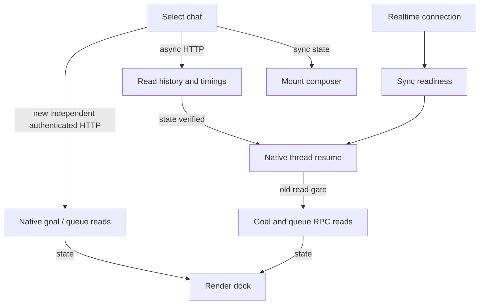

# Dock loading and navigation investigation — 2026-10-29

## Bug summary and reproduction

Select a saved chat while realtime synchronization, HTTP history or native resume is slow. The composer mounts immediately. Goal and steering queue remain absent until all readiness conditions finish. Separately, jumping to an older turn exposes a manual “show subsequent records” button and repeats native reads on later jumps to the same target.

Expected: start authenticated read-only dock requests with chat selection; preserve write readiness checks. Jump directly to the selected request and allow continuous context scrolling without another disclosure step.

## Call chain

The corrected read paths bypass the subscription gate. Actions retain the existing gate and owning Desktop RPC bridge.

## Hypotheses and evidence

1. CSS/animation delay: excluded as the first divergence. No goal/queue requests had started when the composer was mounted.
2. Readiness gates serialize dock reads behind history and resume: confirmed by the instrumented effect runner executing the actual hooks with pending history and realtime.
3. Native request latency alone: not sufficient to explain the delay, since the old client had not yet issued those reads.

Instrumentation uses `[thread-dock]` and `[turn-navigation]` with timing/count/state only. It logs no prompt text, goal objective, paths or credentials.

## Result parity

Correlation key: synthetic chat `synthetic-chat` in the hook integration test, and target `t/u` in navigation tests. No actual chat export is stored.

| Output | Before | After |
|---|---|---|
| Composer mounted with pending history/realtime | yes | yes |
| Goal request started at that point | no | yes |
| Queue request started at that point | no | yes |
| Goal/queue render before history readiness | no | yes |
| Write controls enabled before readiness | no | no |
| Native reads for target with reversible cursor | 3 | 1 |
| Repeat navigation within current memory window | new read | cached |
| Subsequent context | manual button | automatic sentinel |

The first divergence is in client read gating, before native/API execution. The separate navigation cost came from seeding a single item then fetching both sides; the revised seed returns up to 100 target-turn entries directly. Native opaque cursors retain access to surrounding context; an older native shape keeps its existing fallback.

## Minimal changes

- Independent authenticated, noncached HTTP goal/queue reads, cancelled on selection change.
- Ignore older goal responses after a newer native goal event or explicit mutation.
- Add native goal set/clear allowlist entries, explicit user provenance and validation. Preserve omitted budget/status fields when editing the objective; never retry uncertain actions.
- Move the phone outline trigger next to the model selector.
- Automatically continue the bounded navigation window, including cursor-only progress; preserve target/reading position.
- Bound navigation memory to five windows and 30 seconds, invalidating native changes, including native events arriving during an in-flight read. A regression first reproduced the stale-cache race (one read instead of the required fresh second read); a revision guard now prevents caching that response.
- Remove glass appearance and its toggle; retain compact keyboard and safe-area geometry.

## Open-source assessment

- [openai/codex](https://github.com/openai/codex), Apache-2.0: official protocol schemas, 131,458 stars, last push 2026-10-29. Large native repository; use protocol contracts as reference rather than installing or copying its UI. Goal set/clear parameters were also checked against bindings generated by the installed Desktop binary.
- [CoralFlower325/Codex-remote](https://github.com/CoralFlower325/Codex-remote), MIT: current architecture, one star, last push 2026-10-28, one open issue. Existing tests and own Desktop transport provide the compatible extension point.
- [lezi-fun/codex-webui](https://github.com/lezi-fun/codex-webui), MIT: 36 stars, last push 2026-10-20, no open issues returned by the API. A separate frontend would add integration and state synchronization work for these changes.

No new dependency was installed and no third-party UI source was copied. Statistics are a research snapshot, not evidence of defect-free maintenance.

## Verification

- TypeScript server/client type checking passed.
- 56 test files, 338 tests passed, including independent HTTP reads, auth/input rejection and native failures.
- Hook integration tests verify early goal/queue rendering, no unauthenticated reads, native-event precedence, explicit goal mutations, and navigation reuse/invalidation.
- Presentation tests verify full user context and absence of a manual forward disclosure.
- Native paging tests verify one-read target pages, reversible cursors and legacy fallbacks.
- Production build passed.
- Chrome 402×874 phone preview: compact original surfaces, outline trigger beside model, Goal controls fit. Synthetic following context appeared automatically.
- Chrome 874×402 landscape preview also fits. Pause/start/edit/save were clicked against synthetic Goal state. Delete was tested against the same disposable fixture. Native mutations were verified with synthetic RPC responses, without changing a real running goal. Physical iOS acceptance is still separate.

## Limits

The interface loads bounded pages as the reader scrolls; it does not preload an arbitrarily large entire transcript. First navigation and uncached dock data still depend on the host/network. Physical iOS keyboard/network acceptance is separate.
