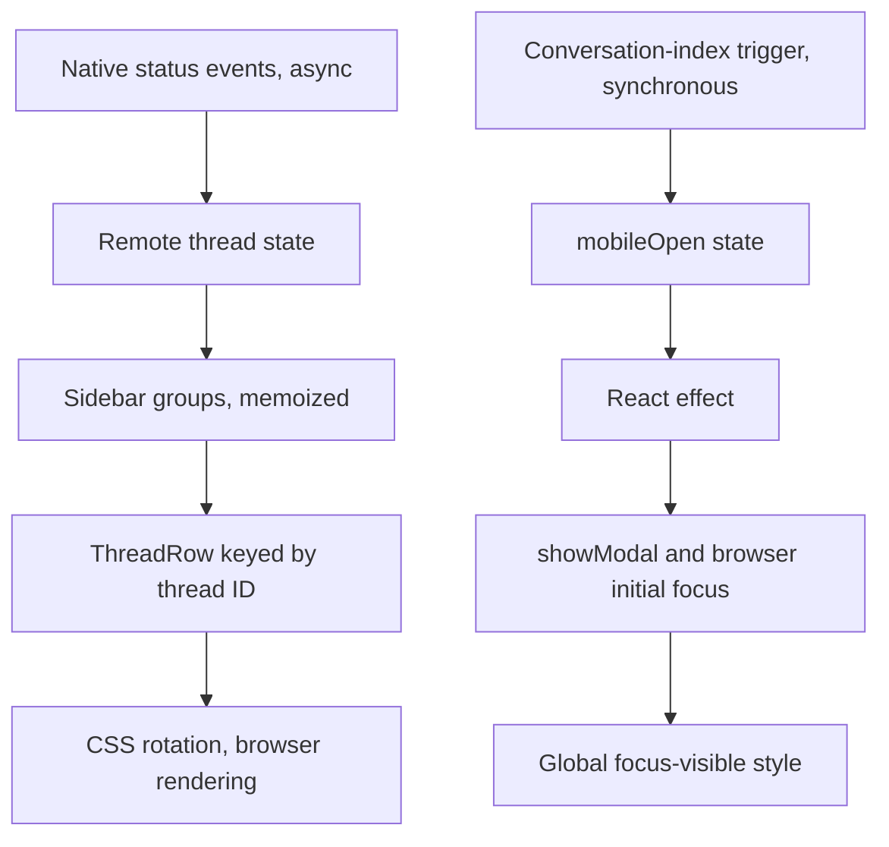

# Sidebar animation and conversation-index sheet

## Symptoms and reproduction

An iOS Home Screen app user reports a short pause when the running conversation
indicator's gap points lower right. Open the conversation sidebar with an active
thread and watch several rotations. The expected result is continuous rotation.
The mobile conversation-index sheet also has mismatched corners and an oversized
close glyph with a black rectangle on opening.

## Call paths

No API or history read is added to either rendering path.

## Hypotheses and instrumentation

1. Rotation easing or SVG rasterization: inspect the same running element's CSS
   matrix, effect progress, transform origin, frame intervals and animation ID.
2. React remount/restart: update a synthetic active thread every 100ms and record
   element and animation identity changes over six seconds.
3. Main-thread stalls/platform-specific rendering: compare frame gaps against
   angular holds, then repeat on the affected Home Screen app.

The ignored local synthetic fixture imports the actual components and production
CSS. It logs `[spinner-diagnostic]` and displays geometry/focus diagnostics. It
never reads native conversations, sends model requests or exports private data.

## Result parity and confirmed cause

Correlation key: synthetic running thread `synthetic-running`.

| macOS Safari measurement, before change | Result |
| --- | --- |
| Six-second frames | 362 |
| Angular holds | 0 |
| DOM/animation restarts | 0 |
| Largest frame interval | 21ms |
| Largest matrix/progress phase difference | 0.8 degrees |
| Duration/easing/origin | 0.9s / linear / 6px 6px |

The matrix matched the computed rotation, including the lower-right gap phase.
This rules out non-linear easing and routine React rerenders as causes **in this
fixture**. It does not reproduce or diagnose the reported physical iOS pause.
No iPhone was detected through the configured USB channel. Subsequent macOS UI
capture became unavailable; no post-change native-browser or physical-phone
smoothness claim is made.

The sheet's black rectangle was visibly reproduced in Safari with the real
component: `showModal()` initially focuses the first button, and the global
`:focus-visible` rule draws a 2px outline. The sheet radius was hardcoded to 8px,
while the composer token is 22px. This first discrepancy is in focus/CSS, not
conversation data or network requests.

## Changes

- Rotate a stable HTML wrapper with explicit 0–360 degree 3D transforms and linear
  timing, keeping the SVG artwork static within it. This is a scoped WebKit
  compatibility mitigation, **not a confirmed physical-iOS root-cause fix**.
  Reduced-motion still overrides the animation. No React frame/timer loop is
  introduced into production code.
- Focus the modal container immediately after opening. Keep Escape/backdrop/close,
  selected-row scrolling, focus restoration and keyboard button outlines.
- Only mobile sheets use the composer corner token and 14px close glyph; the
  close touch target remains 44px. Desktop rail and control geometry stay intact.

## Verification

Regression coverage includes running/idle/approval states on both layouts,
opening focus, selected-row scrolling, frame cleanup, close-state handling,
Escape/backdrop dismissal, focus restoration and native turn/item navigation.
Both the deployment branch and an isolated candidate based on upstream main
passed all 415 tests and the production build (including both TypeScript
compilers). The deployment branch also passed the explicit typecheck command.
Physical iOS Home Screen rotation, reduced-motion and post-change visual
acceptance remain separate live checks. Do not equate passing unit tests with
physical-phone rendering acceptance.
